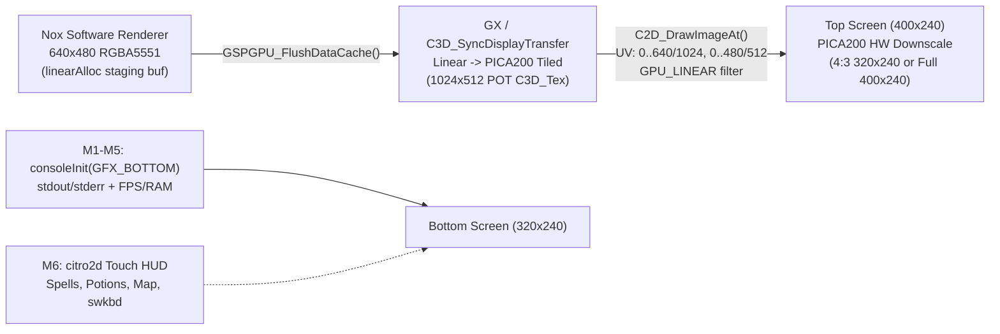

# Nox (nox-decomp-3ds) — New 3DS Port Architecture Blueprint

> **Target Platform:** New Nintendo 3DS / New 2DS XL (ARM11 MPCore @ 804 MHz + L2 cache, 124 MB usable FCRAM, PICA200 GPU, DSP1 Audio)  
> **Toolchain & SDK:** devkitARM + `libctru` + `citro3d` + `citro2d` via `/opt/devkitpro/cmake/3DS.cmake`  
> **Output Artifact:** `nox.3dsx` (homebrew executable) reading game data from `sdmc:/3ds/nox/`  
> **Base Repository:** `nox-decomp-3ds` (pure C decompilation forked from `sookyboo/nox-decomp`, upstream `neuromancer/nox-decomp`)  
> **Reference Bug-Fix Upstream:** `../opennox-3ds` (`v1.8.0`..`v1.9.0-alpha`, `5e76b574..0aae395c`)

---

## 1. Git History & Bug-Fix Triage

### 1.1 What `sookyboo/nox-decomp` Already Fixed on Top of `neuromancer/nox-decomp`

`nox-decomp-3ds` contains 368 commits (16 upstream `neuromancer` commits through `c0999dd` on 2020-06-30, followed by 352 commits from `sookyboo` plus contributors `Mackerel`/`szhublox` and `Brian Degenhardt`). Because `sookyboo` already ported `nox-decomp` to 32-bit ARM Linux handhelds (PortMaster / armhf), several foundational 32-bit ARM hurdles are already solved:

| Area | Key Commits | What Was Fixed / Added | Impact on New 3DS Port |
| :--- | :--- | :--- | :--- |
| **ARM32 Hard-Float ABI Compatibility** | `d70c630`, `e65aec8`, `00584b2`, `ac10013`, `e19d204`, `ef42f7a`, `39e7c16`, `f7c9535` | Introduced `abi_wrappers.c`, `src/GAME_ABI.c`, and `nox_abi_ptrslot_t` / `NOX_CROSS_PTR` in `src/defs.h` guarded by `#if defined(__arm__) && defined(__ARM_PCS_VFP)`. Fixes decompiler-generated functions that pass 32-bit pointer bits inside `float` parameters (VFP `s0` register on AAPCS-VFP): monster strikes (`sub_549220`–`sub_549CA0`), spell ticks (`sub_52DD50`, `sub_52E210`, `sub_52E850`, `sub_52F2E0`, `sub_52F460`, `sub_52F8A0`), monster update (`sub_50A5C0`), trigger xfer (`sub_4F4E50`), summoning (`sub_500F40`), and Wiz Ch.3 barrel cutscene (`sub_5281F0`). Also added alignment-safe float load wrapper stub for `sub_48EA70` (Boots of Running). | **High positive impact.** Verified via `arm-none-eabi-gcc -dM -E -march=armv6k -mfloat-abi=hard`: devkitARM defines `__arm__` and `__ARM_PCS_VFP=1`, so this ABI bridge activates automatically on 3DS. *Caveat:* verify `static void sub_549860__abi_raw` linkage in `abi_wrappers.c:271` during M1. |
| **Solo Campaign Start & Case-Insensitive FS** | `1247869`, `850ade5`, `877ad11`, `94f9355` | Fixed `"This game is only available in a primary installation"` Solo start failure by rewriting `src/compat.c` (`_stat`, `_access`, `compat_open`, `compat_fopen`, `FindFirstFileA`/`FindNextFileA`, `SetCurrentDirectoryA`) with `dos_to_unix()` + `casepath()` + `NOX_FIND_HACKS` (`*.*` → `*`, `Con01a` → `Con01a.*`). Fixed `.map` read-mode corruption (`"g.bin"` → `"rb"` without breaking save writes), case-mismatch map saves when returning to prior levels, save date formatting (`GetDateFormatA`), and made `_chmod` a no-op. | **Directly reusable.** 3DS SDMC (FAT32) is case-insensitive, which simplifies `casepath()`, but `dos_to_unix()`, `C:` stripping, `NOX_FIND_HACKS`, and `.map` `"rb"` mode sanitization remain essential. |
| **Rendering, Pixel Format & Spell VFX** | `0081aa0`, `f6c7e06`, `35dc47c`, `57d1f0a`, `0f61a6e`, `236b253`, `29c35d1`, `5e69080`, `8653a5f`, `1cc83e6`, `1301939`, `0dd285e`, `a2658f1`, `9ef576b` | Switched SDL backbuffer directly to 16-bit `SDL_PIXELFORMAT_RGBA5551` (eliminating per-frame CPU RGBA8888 conversion), fixed cursor RGB555→RGBA5551 colorkey, added 60 FPS frame cap (`SDL_Delay`), linear/integer scaling, and disabled 8-bit/Unlock DX UI buttons. Fixed spell VFX & logic bugs: Death Ray lighting, Force of Nature & Drain Mana distance order-of-operations (`5e69080`), Obliteration rendering (`8653a5f`), laser geometry (`1cc83e6`), and mana obelisk drain (`1301939`). | **Major speedup for 3DS.** `RGBA5551` matches PICA200's native `GPU_RGBA5551` texture format bit-for-bit, allowing zero-conversion texture uploads. |
| **Gamepad Controls & Direct Shortcuts** | `ad4370f`, `e437a75`, `d900cd7`, `6952930`, `95cb984`, `f3c0d28`, `812a32f`, `f08a713`, `30a0d84` | Added MIT-licensed `src/gamepad.c` (1,826 LOC, gptokeyb2-style layered INI remapper) + injectors in `src/input.c` (`nox_ctrl_inject_mouse_move`, `nox_ctrl_inject_mouse_button`, `nox_ctrl_inject_key_scancode`, `nox_ctrl_set_thumbstick_move`, `nox_ctrl_set_thumbstick_jump`). Added radial cursor limiter (`NOX_LIMIT_RANGE_ON_RUN_*`, default radius `118`), 3 thumbstick modes (relative, absolute, inverted-run), direct spell-set shortcuts (`30a0d84`), and Select-to-skip movies (`g_movie_skip_requested`). | **Directly adaptable.** Replace `SDL_GameController` polling in `gamepad.c` with `libctru` `hidKeysHeld()` + `hidCircleRead()` + `hidCstickRead()` while reusing the entire layer/action/radial-clamp engine. |
| **Audio Format Support & Looping** | `2755c9b`, `e68bba7`, `743f879`, `5e12ccf`, `f22aa65`, `bd14c8c`, `4b1960f`, `2b93c32`, `902b7d5` | Added native decoding in `src/compat_mss.c` for all 3 Nox stream formats: PCM16 (`0x01`), IMA ADPCM (`0x11`), and MP3-in-WAV (`0x55` via bundled `src/minimp3.h` with `MINIMP3_NO_SIMD`), eliminating the old `docs/dialogconv.md` FFmpeg batch-conversion requirement. Fixed OpenAL buffer queue overflows and added intra-block ADPCM seek PCM caching (`bd14c8c`) to remove music loop clicks. | **Important caveat:** `bd14c8c` added a **64 KB stack array** (`int16_t tmp[16*1024*2]`) in `stream_adpcm_seek` (`compat_mss.c:668`) that must be moved off-stack on 3DS. |
| **Gameplay, Video & Networking** | `cde5a30`, `3302bad`, `ac301fb`, `736e9f2`, `adfe080`, `0d451ef`, `175a840`, `f14089f` | Added FFmpeg `.vqa` playback in `src/movie.c` (with `NOX_SKIP_MOVIES` / `NOX_SKIP_INTRO_MOVIES` bypasses in `draw.c:4036,4077`), fixed summon limits/crashes & Lich Lord summon counter (`175a840`), inventory durability/float formatting (`2cc50d3`, `3302bad`), and multiplayer LAN/lobby/UPnP/telnet control server (`lobby.c`, `upnp.c`, `netextras.c`, `control_server.c`). | On 3DS, FFmpeg, `lobby.c`, `upnp.c`, `netextras.c`, and `control_server.c` will be excluded/stubbed to minimize binary size and eliminate network thread/socket overhead. |

---

### 1.2 Prioritized Backport Table from `../opennox-3ds` (`v1.8.0`..`v1.9.0-alpha` & `src/legacy/`)

Querying `git -C ../opennox-3ds log 5e76b574..HEAD` (213 fix commits across `v1.8.0`–`v1.9.0-alpha`, including `src/legacy/` C files) yields the following prioritized backport table for **Milestone 4**. All fixes below map directly to existing C functions in `src/GAME1.c`–`src/GAME5.c`, `src/string.c`, and `src/compat_mss.c`:

#### Priority Legend
- **P0 (Critical):** Prevents campaign softlocks, guaranteed crashes, heap/stack corruption, or thread data races on 3DS.
- **P1 (High):** Fixes broken single-player mechanics, NoxScript regressions, or late-game spell/AI bugs.
- **P2 (Medium):** Hardening, edge-case crash guards, and quality-of-life fixes.

| Priority | Category | OpenNox Commit | Issue / Symptom | Target C Function(s) in `nox-decomp-3ds` | Backport Notes |
| :---: | :--- | :--- | :--- | :--- | :--- |
| **P0** | **Audio Race** | `a1c96b23` | Data races & crashes on audio playback (#376): `AIL_start_timer` invokes game mixer (`sub_43E9D0`) from background timer thread while main thread mutates audio queues. | `src/compat_mss.c` (`AIL_start_timer`, `AIL_serve`, `AIL_release_timer_handle`, `AIL_release_sample_handle`) | Dispatch Miles timer callbacks synchronously inside `AIL_serve()` (called by `sub_43F140` / main loop) and guard all sample/stream handles; also properly free handles on release. |
| **P0** | **Audio Error** | `21777178` | Crash on audio device/buffer errors or invalid handle dereference (#502). | `src/compat_mss.c` (all `AIL_*` entry points) | Validate `HDIGDRIVER`/`HSAMPLE`/`HSTREAM`/`HTIMER` pointers and abort cleanly on `ndsp`/backend errors instead of crashing or corrupting `hwbuf[]`. |
| **P0** | **Campaign** | `11eeb4c7` | Banishing captured creatures (e.g., vampire bats) breaks script death/banish triggers, softlocking campaign progression (#286). | `src/GAME4.c`: `sub_5017F0` (`nox_xxx_banishUnit_5017F0`) | 8-line C patch invoking script callback before deleting banished unit. |
| **P0** | **Campaign** | `12a82122` | Monster initialization overwrites scripted monster AI stack, breaking campaign NPCs/boss scripts. | `src/GAME3.c`: `sub_4E6...` / monster init (`src/legacy/GAME3_3.c` `LABEL_15`) | 3-line guard checking existing AI stack before pushing default idle/wander state. |
| **P0** | **Campaign** | `0a155683` | "Deafness" bug (#328): creatures/NPCs fail to hear footsteps/sounds due to polygon/wall-map pointer/index bugs. | `src/GAME1.c`: `sub_421790`, `sub_4217B0`, `sub_429B20`; `src/GAME4.c` | Directly inspect OpenNox C diff across `GAME1_1.c`/`GAME1_2.c`/`GAME4_1.c` and port pointer arithmetic fixes. |
| **P0** | **Campaign** | `661f63e2` | Infinite loop / freeze when loading corrupted autosave files. | `src/GAME1.c`: `sub_41A000` | 1-line fix breaking out of read loop on EOF/short read. |
| **P0** | **Campaign** | `b087ce47` | Crash when player steps/falls into a pit (#424). | `src/GAME2.c`: `sub_49F610`, `sub_49F6F0` | Guard null/out-of-bounds sprite rect during fall-into-pit draw sequence. |
| **P0** | **Campaign** | `e52642d6`, `804e7df7` | Player unit deleted on boundary position check (#401), causing immediate crash. | `src/GAME4.c`: `sub_5175E0`, `sub_517780`, `sub_5178E0`, `sub_517970`; `src/GAME3.c`: `sub_4DE530` | Prevent `sub_517780`/`sub_517970` from deleting player units out of bounds; add null-unit survival guards. |
| **P0** | **GUI Memory** | `42a5d846` | Heap corruption / OOB writes in GUI listbox array allocation & access (#400). | `src/GAME2.c`: `sub_457B60`, `sub_459A40`, `sub_459AA0`; `src/GAME3.c`: `sub_4A30D0` | Bounds-check listbox capacity/count and fix reallocation size calculation. |
| **P0** | **GUI Memory** | `5730df24` | Crash / invalid read when concatenating empty wide strings (#655). | `src/string.c`: `nox_wcscat` | Add null/empty-string guard at entry of `nox_wcscat`. |
| **P0** | **GUI Memory** | `a7951797`, `8ac0f09b` | Stack/buffer overflows in map validation, map save, and startup path buffers (#490). | `src/GAME1.c`: `sub_4161E0`; `src/GAME3.c`: `sub_4CF470`, `sub_4D0550`; `src/GAME4.c`: `sub_51E010`; `src/GAME5.c`: `sub_57A950` | Replace unchecked `strcpy`/`sprintf` with bounded copies. |
| **P0** | **Spells** | `f1a58374` | Crash / OOB table read when casting or upgrading spells above level 5 (#656). | `src/GAME3.c` / `src/GAME4.c`: `sub_4FD400` (`nox_xxx_spellAccept_4FD400`) | Clamp spell level to `[1..5]` before indexing level tables. |
| **P0** | **Spells** | `6379db51` | Stack overflow and incorrect signed/unsigned types in Obliteration / Mana Bomb FX (#488). | `src/GAME2.c`: `sub_499490`, `sub_499520`; `src/GAME3.c`: `sub_4CA720` | Verify against sookyboo's `8653a5f`; ensure fixed-size local stack arrays & unsigned types cannot overflow on 3DS. |
| **P1** | **NoxScript** | `e476e7b5` | String buffer overflow in NoxScript builtins. | `src/GAME4.c` (NoxScript builtin handlers `sub_512...`–`sub_516...`) | Bound string copy lengths inside NoxScript string builtins. |
| **P1** | **NoxScript** | `b4e4299c` | Scripts fail to enable/disable waypoint groups (#686). | `src/GAME4.c` / `src/GAME5.c` (waypoint group enable builtin + `sub_57C0A0`) | Propagate `enable` flag correctly across all waypoints in a `MapGroup`. |
| **P1** | **NoxScript** | `0a7c5a96`, `dd5f1c46` | Wrong return/index types in `sub_57C0A0` / `sub_57C130` map group lookup. | `src/GAME5.c`: `sub_57C080`, `sub_57C090`, `sub_57C0A0`, `sub_57C130` | Fix signed/unsigned group index lookup and pointer return type. |
| **P1** | **NoxScript** | `670ac1b4` | `GREEN_BOLT` script `Effect()` fails to trigger. | `src/GAME4.c`: `sub_514210` | Fix opcode/effect enum mapping in `nox_script_Effect_514210`. |
| **P1** | **Campaign** | `851b3d9a` | Jumping prevents taking lava/hazard damage (#422). | `src/GAME4.c`: `sub_4F8460` (`nox_xxx_unitUpdatePlayerImpl_4F8460`) | 2-line fix resetting jump-invulnerability flag after landing. |
| **P1** | **Campaign** | `737194f4` | Opening locked doors with keys fails in edge cases. | `src/GAME3.c`: `sub_4D72B0`; `src/GAME5.c`: `sub_57B4D0` | Fix key-item ownership check across player inventory. |
| **P1** | **Campaign** | `9a0b696f` | Crash when riding an elevator with Haste active (#600). | `src/GAME2.c` (client drawable 2D spatial index removal) | Null-check drawable spatial-list link before unlinking on fast elevation transitions. |
| **P1** | **Campaign** | `ff500adf` | Crash when picking up bow or arrows. | `src/GAME4.c`: `sub_53A420` (`nox_xxx_playerEquipWeapon_53A420`) | 1-line null check on currently equipped weapon/ammo slot. |
| **P1** | **Campaign** | `15d0a1f6` | Crash when adding projectiles outside map bounds (#403). | `src/GAME4.c`: `sub_517780` | Validate tile/coordinate bounds before inserting projectile into map spatial grid. |
| **P1** | **Campaign** | `0b5e6a8c`, `0ea9088c`, `cedf94ca` | Crashes when monster max health overflows 16-bit/signed bounds or invalid direction index is set. | `src/GAME4.c`: `sub_50A5C0`, `sub_509E20` | Clamp health ratio computation and mask direction index to valid range (`& 0xFF` / `0..7`). |
| **P1** | **Spells** | `235900a5`, `9db5e817` | Homing missiles / Pixies target dead entities (#417); Energy Bolt fails in wall traps (#368). | `src/GAME3.c`: `sub_4EC520`, `sub_4EC580`; `src/GAME4.c`: `sub_540440`, `sub_540780`, `sub_52E850` | Skip dead/dying units in `spellFlySearchTarget` and fix trap caster parent check. |
| **P1** | **GUI Memory** | `7232f915`, `2de5b3fa`, `57e73307`, `cdcb39b4` | Crash creating GUI dialogs with null parent, crash when no player saves exist, invalid image memory access (`sub_4C97F0`), unsafe wide-string helper (`sub_46E170`, #333). | `src/GAME2.c`: `sub_46E170`; `src/GAME3.c`: `sub_4A5150`, `sub_4C97F0`, GUI dialog creation | Add null guards on parent window, empty save list, and font/image buffers. |
| **P2** | **Campaign / GUI** | `e0384026`, `2968ea97`, `6c0c726f`, `e53d2df8`, `9d9db2e6`, `cf6e6072` | Map rule buffer layout (`sub_57AAA0`), Warcry during Berserk (#521), enchant/spell-by-title null lookup (#511/#487), spawned creatures stuck when damaged (#428), line intersection (#307). | `src/GAME5.c`: `sub_57AAA0`; `src/GAME1.c`: `sub_424880`, `sub_424960`; `src/GAME4.c` | Clean localized C fixes; apply during Milestone 4 hardening pass. |

---

## 2. Platform Boundary & Subsystem Audit

### 2.1 Complete Dependency Inventory & `libctru` Shim Mapping

Automated scanning of `src/` shows that all desktop platform dependencies are tightly concentrated in a small set of wrapper files, with only minimal leakage into `GAME1.c` (19 `SDL_*` calls, 4 critical sections), `GAME2.c` (1 critical section), and `GAME5.c` (64 Winsock calls).

| Subsystem | Current Source Files & Calls | New 3DS Replacement (`port/3ds/`) |
| :--- | :--- | :--- |
| **Entry Point & Lifecycle** | `src/main.cpp` (`main`), `src/win.c` (`WinMain`, `sub_4453A0` event pump, `SDL_Init`, `SDL_CreateWindow`, `SDL_PollEvent`), `src/GAME1.c` (`SDL_SetWindowFullscreen`, `SDL_SetWindowSize`) | `port/3ds/platform_3ds.c`: `osSetSpeedupEnable(true)`, `gfxInitDefault()`, `C3D_Init()`, `C2D_Init()`, `ndspInit()`, `romfsInit()` (optional), `chdir("sdmc:/3ds/nox")`. `sub_4453A0()` pumps `aptMainLoop()` + `hidScanInput()` + `nox_3ds_input_poll()`. Window resize/fullscreen calls in `GAME1.c` become no-ops fixed to 640×480 logical size. |
| **2D/GPU Video & Present** | `src/draw.c` (127 `SDL_*` + 122 `gl*` calls: `SDL_Surface`, `SDL_CreateRGBSurfaceWithFormat`, `SDL_BlitScaled`, `SDL_GL_*`, `glTexImage2D`, `glTexSubImage2D`, GLSL gamma shader, `sdl_present`, `sub_48B000`, `create_surfaces`) | `port/3ds/video_3ds.c`: Replace `SDL_Surface` with a lightweight `nox_surface_t` (`w, h, pitch, format, pixels, is_linear`). Allocate 640×480 RGBA5551 backbuffer in `linearAlloc()`, copy/tile to 1024×512 `C3D_Tex` (`GPU_RGBA5551`) via `GSPGPU_FlushDataCache()` + `C3D_SyncDisplayTransfer()`, draw scaled quad to 400×240 top `C3D_RenderTarget` via `citro2d`. Replace `SDL_BlitScaled` (used only for `g_cursor_surf` blit in `draw.c:2292`) with a 25-line RGBA5551 colorkey software blitter. |
| **Audio (Miles Sound System)** | `src/compat_mss.c` (45 OpenAL `al*`/`alc*` + 24 `SDL_*` mutex/timer calls), `src/minimp3.h` | `port/3ds/audio_3ds.c`: Implement `compat_mss.h` (`AIL_*`) directly on `libctru` `ndsp` (24 hardware DSP channels: channels 0–15 for `HSAMPLE` SFX, channels 16–17 for `HSTREAM` music & dialog). Allocate double-buffered PCM16 `ndspWaveBuf` blocks via `linearAlloc()` and flush with `DSP_FlushDataCache()`. Reuse `decode_adpcm`, `decode_adpcm_stereo`, and `minimp3.h` (`MINIMP3_NO_SIMD`). Dispatch `AIL_register_timer` callbacks synchronously in `AIL_serve()`. |
| **Input & Text Entry** | `src/input.c` (47 `SDL_*`), `src/gamepad.c` (78 `SDL_*`), `src/imm.c` (`SDL_StartTextInput` / `SDL_StopTextInput`) | `port/3ds/input_3ds.c`: Poll `hidScanInput()`, `hidKeysHeld()`, `hidCircleRead()`, `hidCstickRead()`, `hidTouchRead()`. Feed directly into `gamepad.c`'s physical-input struct (`g_cur`) and `input.c`'s `nox_ctrl_inject_*` / `nox_ctrl_set_thumbstick_*` queues. Map `sub_5700CA` (IME start, e.g., character/save naming) to 3DS `swkbdInit` / `swkbdInputText` in M6 (or default name stub in M2–M3). |
| **Timing & Synchronization** | `src/defs.h` (`__rdtsc` via `SDL_GetPerformanceCounter`), `src/GAME1.c` (`SDL_GetTicks`, `SDL_Delay`), `src/compat.c` (`Sleep`, `timeGetTime`, `GetTickCount`, `QueryPerformanceCounter`, `InitializeCriticalSection` via `SDL_mutex`, `CreateMutexA`/`_beginthread`/`WaitForSingleObject` via `pthread`) | `port/3ds/platform_3ds.c`: `osGetTime()` (ms) for `timeGetTime`/`GetTickCount`; `svcGetSystemTick()` (`SYSCLOCK_ARM11 = 268111856` Hz) for `__rdtsc` and `QueryPerformanceCounter`; `svcSleepThread(ms * 1000000LL)` for `Sleep`/`SDL_Delay`. Use `RecursiveLock` (`libctru` `<3ds/synchronization.h>`) for `CRITICAL_SECTION` and `CreateMutexA`; `threadCreate()` for `_beginthread()` if invoked. |
| **Filesystem & Registry** | `src/compat.c` (`compat_fopen`, `compat_open`, `_stat`, `_access`, `FindFirstFileA`/`FindNextFileA`, `CreateFileA`, `CopyFileA`, `CreateDirectoryA`, `GetCurrentDirectoryA`, `RegOpenKeyExA`/`RegQueryValueExA`) | `port/3ds/fs_3ds.c`: Keep `compat.c`'s `dos_to_unix()`, `C:` stripping, `NOX_FIND_HACKS`, `.map` `"rb"` guard, and virtual `Serial` registry key. Replace Linux-specific `get_current_dir_name()`, `readlink("/proc/self/exe")`, and `fstatat()` with devkitARM newlib `getcwd()`, `stat()`, and root prefix `sdmc:/3ds/nox/`. Remove `glob.h` / `fnmatch.h` (unused in active code). |
| **Sockets & Networking** | `src/compat.c` (65 socket calls), `src/GAME5.c` (64 Winsock calls), `src/sm.c` (7 calls), `src/netextras.c`, `src/lobby.c`, `src/upnp.c`, `src/control_server.c` | `port/3ds/net_loopback_3ds.c`: Pure in-memory UDP loopback ring buffer (Section 2.2) — **no `socInit()`**. Exclude `lobby.c`, `upnp.c`, `control_server.c`, and `netextras.c` from 3DS target; provide no-op link stubs for `nox_netextras_*` and `nox_control_server_*`. |
| **Cutscenes (`.vqa`)** | `src/movie.c` (16,584 LOC; 67 FFmpeg + 68 SDL2 + 21 OpenAL calls), `src/draw.c` (`sub_4B0300`, `sub_4B0340`, `sub_4B05D0`, `sub_4B0640`) | `port/3ds/movie_stub_3ds.c`: Exclude `src/movie.c` and all FFmpeg libraries in Milestones 1–6 (Section 2.3). |

---

### 2.2 Single-Player Client/Server Communication & In-Memory Loopback Transport

Auditing `src/GAME3.c`, `src/GAME5.c`, and `src/sm.c` reveals a **two-path** client/server architecture:

1. **Pure Solo Campaign Fast Path (`sub_40A5C0(0x800)` = Solo flag set):**
   - In `src/GAME3.c:35095` (`sub_4D1660`, server startup), when `sub_40A5C0(2048)` is true, the engine **skips** `sub_4DEBC0()` (`sub_554380`), so no server UDP listening socket is opened.
   - In `src/sm.c:182` (`CONNECT_PREPARE`), because `sub_40A5C0(1)` (Host flag) is set, the local player joins slot `31` directly via `sub_4DD320(31, Data)`.
   - Each tick, `src/GAME3.c:45407` (`sub_4DEB50`) pumps local player `31`'s serialized packets directly in-memory via `sub_40ED60(31, 0, &len)` → `sub_51BAD0(31, buf, len)`.
2. **Solo Quest / Local Host / LAN Discovery UDP Path (`!sub_40A5C0(0x800)` or `sub_554B40`):**
   - When Solo Quest or local host modes run, `sub_4DEBC0` → `sub_554380` calls `WSAStartup`, `socket(AF_INET, SOCK_DGRAM, 0)`, `bind(port 18590)`, `gethostname()`, `gethostbyname()`.
   - Client/discovery code (`sub_5546F0`, `sub_554760`, `sub_554B40`, `sm.c:NET_CONNECT`) opens UDP sockets and polls/exchanges datagrams via `ioctlsocket(FIONREAD=0x4004667F / FIONBIO=0x8004667E)`, `sendto()`, and `recvfrom()` (`sub_551F90`, `sub_552020`, `sub_552A80`, `sub_552460`).
   - File transfer (`GAME5.c:14345`) also references TCP `socket(2, 1, 0)` + `ioctlsocket(FIONBIO)`.

#### Why We Must NOT Call `socInit()` on 3DS
On 3DS, `socInit()` requires a 0x1000-aligned shared buffer (`0x100000` = 1 MB minimum) and fails or stalls when Wi-Fi is disabled (airplane mode / wireless switch off). Single-player Nox has zero need for real network hardware.

#### In-Memory Ring-Buffer Loopback Design (`port/3ds/net_loopback_3ds.c`)
We replace the Winsock/BSD socket layer in `compat.c` with a self-contained virtual UDP table (~200 LOC):
- **Virtual Socket Table:** `MAX_LOOPBACK_SOCKS = 16`, returning synthetic FDs `1024..1039` (disjoint from newlib stdio FDs).
- **Per-Socket RX Ring Buffer:** `32` slots × `2048` bytes max datagram (64 KB per active socket, allocated on `socket()` and freed on `closesocket()`), storing `{ uint32_t src_ip; uint16_t src_port; uint16_t len; uint8_t data[2048]; }`.
- **Routing Semantics:**
  - `bind()` registers `{bound_ip, bound_port}` (assigning ephemeral ports starting at `49152` if `sin_port == 0`; returning `-1` + `WSAEADDRINUSE = 10048` on port collision so Nox's port-increment loop in `sub_554380:11797` and `sm.c:284` works identically).
  - `sendto()` resolves destination `{ip, port}`: if destination is `127.0.0.1`, `0.0.0.0`, local virtual IP, or `255.255.255.255`, enqueue a copy into every matching bound socket's RX ring buffer (dropping oldest or returning `WSAEWOULDBLOCK` if full). External non-loopback IPs silently return `length` (no error, no stall).
  - `ioctlsocket(FIONREAD = 0x4004667F)` returns the byte length of the head datagram in the RX ring (`0` if empty).
  - `ioctlsocket(FIONBIO = 0x8004667E)` stores the non-blocking flag and returns `0`.
  - `recvfrom()` pops the head datagram, fills `sockaddr_in`, and returns `len`; if empty, sets `last_socket_error = 10035` (`WSAEWOULDBLOCK`) and returns `-1`.
  - `gethostname()` returns `"n3ds-local"`; `gethostbyname()` returns a static `hostent` pointing to `127.0.0.1` (`0x0100007F` in network byte order).

---

### 2.3 Audio Codec (`audio.bag` / Music / Dialog) & `.vqa` Cutscene Hooks

#### Audio Asset & Codec Matrix

| Audio Source | Engine Entry Points | Container / Format | Decoder on 3DS |
| :--- | :--- | :--- | :--- |
| **Sound Effects (`audio.bag` + `audio.idx`)** | `sub_4310B0` → `sub_4866F0` (`audio.idx` RAM table, 36-byte records searched via `bsearch` in `sub_486A10`) → `AIL_allocate_sample_handle` (16 voices, `sub_4311F0:42836`) → `AIL_load_sample_buffer` (two 16 KB staging buffers per voice in `sub_43EC30`) | **IMA ADPCM** (`0x11`), 22050 Hz, mono (`block_size=1024`) or stereo (`block_size=2048`), 4-bit nibbles | Keep `compat_mss.c`'s `decode_adpcm` / `decode_adpcm_stereo` (pure integer C, negligible CPU at 804 MHz) → output PCM16 into `linearAlloc` `ndspWaveBuf`s (`DSP_FlushDataCache`). |
| **Music (`music\*.wav`)** | `GAME1.c:50995` → `AIL_open_stream` / `AIL_set_stream_position` / `AIL_start_stream` | RIFF WAV, **`wFormatTag == 0x11` (IMA ADPCM)** with `fact` chunk and cue-point looping | Keep `stream_adpcm_decode` + `stream_adpcm_seek` (after moving `int16_t tmp[32768]` from stack to struct/heap!) → `ndsp` channel 16. |
| **NPC Dialog (`dialog\*.wav`)** | `GAME2.c:568` → `AIL_open_stream` | RIFF WAV, **`wFormatTag == 0x55` (MP3-in-WAV**, `MPEGLAYER3WAVEFORMAT` `cbSize=12`) or `0x01` (PCM16 if user pre-converted) | Keep bundled `src/minimp3.h` (`MINIMP3_ONLY_MP3`, `MINIMP3_NO_SIMD`) + `stream_pcm_decode` → `ndsp` channel 17. No external FFmpeg/libmpg123 required. |

#### `.vqa` Cutscene Playback Hooks & Clean Stubbing
Tracing all movie references across `src/GAME1.c`–`src/GAME5.c`, `src/draw.c`, and `src/movie.c` shows a very clean 5-function boundary:
- `sub_4B0300(char *filename)` (`src/draw.c:4033`): queues up to 2 `.vqa` filenames into `byte_5D4594[1311940]` (count at `byte_5D4594[1311928]`).
- `sub_4B0640(int (*cb)(void))` (`src/draw.c:4260`): registers the **post-movie completion callback** at `byte_5D4594[1311924]` (critical for campaign chapter transitions: `GAME3.c:288,6788,6817,6841`, `GAME5.c:14266`).
- `sub_4B0340(int a1)` (`src/draw.c:4055`): plays queued movies via `sub_555430()`, then calls `sub_4B05D0()`.
- `sub_4B05D0()` (`src/draw.c:4244`): clears queue/active flags (`1311936`, `1311928`), calls `sub_440900()`, and invokes the completion callback at `byte_5D4594[1311924]`.
- `sub_555430(HWND *a1)`, `sub_555500(char)`, `sub_555510()` (`src/movie.c`): FFmpeg VQA decoder & abort flag (`g_movie_skip_requested`).

**Early-Milestone Strategy (Milestones 1–6):**
Exclude `src/movie.c` (16,584 LOC) and all 5 FFmpeg libraries (`libavformat`, `libavcodec`, `libavutil`, `libswscale`, `libswresample`) from the 3DS CMake build. Provide `port/3ds/movie_stub_3ds.c` defining `g_movie_skip_requested`, no-op `sub_555430`/`sub_555500`/`sub_555510`, and short-circuiting `sub_4B0340` directly to clear the movie queue and call `sub_4B05D0()` (matching the already-proven `NOX_SKIP_MOVIES` path in `draw.c:4079-4091`). This guarantees intro logos, class intros, and chapter transitions advance seamlessly without stalling.

---

## 3. New 3DS Hardware & ARM11 Constraints

### 3.1 CPU Clock, L2 Cache, ABI & Stack Budget

1. **New 3DS Speedup:** Call `osSetSpeedupEnable(true);` as the very first hardware call in `main()`. In `.3dsx` homebrew on New 3DS, this enables the 804 MHz ARM11 clock and 2 MB L2 cache (3× CPU throughput over Old 3DS 268 MHz) while remaining a safe no-op on Old 3DS. Log `APT_CheckNew3DS()` at boot on the bottom console and display a clear warning if running on Old 3DS (which lacks both the 804 MHz clock and 124 MB FCRAM needed for Nox).
2. **Main Thread Stack (`1 MB`):** Declare at global scope in `port/3ds/platform_3ds.c`:
   ```c
   u32 __stacksize__ = 1024 * 1024;
   ```
   **Why this is mandatory (verified via static stack-frame audit of `src/`):** `libctru`'s default 32 KB stack would crash immediately. Our scan of `src/` found massive local stack frames in core game and audio functions:
   - `src/GAME3.c:43510-43511`: `v23[16384]` + `v24[131072]` = **144 KB** in a single function frame.
   - `src/GAME3.c:43656-43657`: `v30[16384]` + `v31[131072]` = **144 KB** in a single function frame.
   - `src/GAME4.c:34855-34856`: `v60[15360]` + `v61[61440]` = **75 KB** in a single function frame.
   - `src/compat_mss.c:668`: `int16_t tmp[16 * 1024 * 2]` = **64 KB** inside `stream_adpcm_seek` (**must** be moved to `struct _STREAM` or `malloc` so it never blows an audio/worker thread stack!).
   - `src/compat_mss.c:1297`: `signed short decoded[4096]` = **8 KB** inside `sample_play_adpcm`.
3. **Mandatory Compiler Flags (devkitARM):**
   - `-march=armv6k -mtune=mpcore -mfloat-abi=hard -mtp=soft` (supplied by `3DS.cmake`).
   - **`-fshort-wchar`** (mandatory! Verified via `arm-none-eabi-gcc -dM -E`: default `__SIZEOF_WCHAR_T__` is `4`, whereas Nox `.csf`/`nox.str` and `string.c` require 16-bit UTF-16 `wchar_t`).
   - `-fno-strict-aliasing -fno-strict-overflow -fcommon -Wno-error=int-conversion -Wno-error=incompatible-pointer-types`.
   - Optimize `GAME1.c`–`GAME5.c` at `-O2` (with `-O1`/`-O0` fallback per-file if any decompiler UB surfaces; `src/CMakeLists.txt` currently compiles at `-O0`, which would be too slow for 804 MHz ARM11 software rasterization).

---

### 3.2 Memory Budget (< 110 MB FCRAM Cap) & Cache Coherency

New 3DS homebrew has ~124 MB of usable FCRAM shared between the regular newlib heap (`malloc`) and the physically contiguous linear pool (`linearAlloc()`). Measuring the existing 32-bit Linux ELF (`build-linux/src/out`) gives a precise baseline:

| Memory Region | Pool | Measured / Budgeted Size | Notes |
| :--- | :--- | :---: | :--- |
| ELF `.text` + `.rodata` + `.data` + `.bss` | Static | **~7.5 MB** | Linux 32-bit ELF measured `3.58 MB text + 0.35 MB data + 4.19 MB bss = 8.12 MB` *including* `movie.c`, `lobby.c`, `upnp.c`, `control_server.c`. Excluding those trims `.text` by ~0.6 MB. |
| Main Stack + Audio/Helper Stacks | Static/Sys | **1.1 MB** | `__stacksize__ = 1 MB` + 64 KB audio thread (if threaded). |
| `video.idx` & `audio.idx` RAM Lookup Tables | Regular Heap | **~4.5 MB** | `sub_42F0B0`/`sub_42F200` already parse all of `video.idx` into RAM (`byte_5D4594[787148]` + `[787152]`), and `sub_4866F0` loads all of `audio.idx` into a sorted 36-byte record array in RAM. **Keep both resident** to eliminate SD random seeks on index lookups. |
| `video.bag` Sprite Slab Cache + Stdio Buffers | Regular Heap | **~24.0 MB** | Tune `video.bag` LRU cache (`byte_5D4594[787200]`) and attach `setvbuf(..., _IOFBF, 65536)` to open `video.bag` (`byte_5D4594[787204]`) and `audio.bag` `FILE*` handles to amortize SD card read latency. |
| Map Geometry, Units, Drawables, UI `.wnd`, NoxScript | Regular Heap | **~32.0 MB** | Peak during large campaign chapters (e.g., Ix / Dun Mir / Galava / Land of the Dead). |
| Loopback Net Ring Buffers & Misc Runtime | Regular Heap | **~1.0 MB** | Virtual UDP buffers (max 16 sockets × 64 KB only when opened; ~128 KB typical). |
| GPU 1024×512 POT Texture + 640×480 Staging Buffer | `linearAlloc()` | **~2.6 MB** | 1024×512×2 B (`C3D_Tex` in VRAM if available, else linear = 1.0 MB) + 1024×512×2 B or 640×480×2 B double-buffered linear upload staging (~1.2–2.0 MB). |
| `ndsp` Audio Buffers (16 SFX + 2 Streams, double-buffered) | `linearAlloc()` | **~0.5 MB** | 16×2×8 KB (`256 KB`) + 2×2×32 KB (`128 KB`) + scratch (`64 KB`). |
| `citro3d` / `citro2d` Command Buffers & Render Targets | `linearAlloc()` / VRAM | **~2.0 MB** | Standard `C3D_DEFAULT_CMDBUF_SIZE` + top/bottom targets in VRAM. |
| **Total Estimated Peak** | **Combined** | **~75.2 MB** | **~35 MB safety margin under the 110 MB cap** (and ~49 MB under 124 MB FCRAM). |

#### Mandatory Cache Coherency Rules
ARM11's L1/L2 data caches are **not hardware-coherent** with the PICA200 GPU or DSP1:
1. **GPU Textures (`video_3ds.c`):** Allocate software framebuffer / texture staging buffers via `linearAlloc()` (16-byte aligned). Immediately after the engine finishes software rendering into the 640×480 buffer and **before** `C3D_SyncDisplayTransfer()` / `GX_DisplayTransfer()` (or direct PICA200 sampling), call:
   ```c
   GSPGPU_FlushDataCache(staging_buf, staging_size);
   ```
2. **DSP Audio (`audio_3ds.c`):** Allocate all `ndspWaveBuf.data_vaddr` PCM buffers via `linearAlloc()`. Immediately after decoding IMA ADPCM / MP3 samples and **before** `ndspChnWaveBufAdd(ch, &wb)`, call:
   ```c
   DSP_FlushDataCache(wb.data_vaddr, bytes_written);
   ```
3. **Monitoring:** Expose `linearSpaceFree()` and heap usage (`mallinfo().uordblks`) in the bottom-screen debug header during Milestones 1–5 to verify memory stays strictly `< 110 MB` across level transitions.

---

### 3.3 ARM11 Alignment Audit (`src/` Scan Findings)

Although ARMv6K (`-march=armv6k`, SCTLR `U=1, A=0` on 3DS) supports unaligned single-register integer `LDR`/`STR`/`LDRH`/`STRH` in hardware, **VFP floating-point loads/stores (`VLDR`/`VSTR` on `float*`/`double*`) and multi-register transfers (`LDM`/`STM`/`LDRD`/`STRD`) ALWAYS trigger an ARM11 Alignment Data Abort** on real hardware (and Citra's strict alignment mode).

Our automated scan of `src/` identified **three concrete hazard classes**:

| Hazard Class | Count in `src/` | Concrete Examples Found | Severity on ARM11 | Mitigation |
| :--- | :---: | :--- | :---: | :--- |
| **1. Unaligned `*(float *)` / `*(double *)` casts** | **53 sites** | `GAME2.c:50004` (`*(float *)(v3 + 3)`), `GAME3.c:20554-20559` (`*(float *)&v35[1..3]`), `GAME3.c:48495-48503` (`*(float *)&a3a[1..2]`), `GAME4.c:3796-3797` (`*(float *)&v7[1..2]`), `GAME4.c:3837-3838`, `GAME4.c:3930-3933`, `GAME4.c:8290-8291`, `GAME4.c:47386-47388` | **CRITICAL (Guaranteed `VLDR`/`VSTR` Data Abort!)** | Replace all 53 sites with inline `nox_read_f32()` / `nox_write_f32()` (`memcpy` to/from stack `float`). |
| **2. Unaligned `video.idx` / `RIFF` / packet buffer `_WORD*` & `_DWORD*` casts** | **1,209 sites** (`GAME2.c`: 662, `GAME3.c`: 302, `GAME4.c`: 137, `GAME1.c`: 74, `GAME5.c`: 22, `movie.c`: 10, `sm.c`: 2) | `GAME1.c:41035-41087` (`sub_42F200` parsing variable-length `video.idx` records via `v14 = v12 + 1; v15 = *v14`), `sm.c:169-170` (`*(_DWORD *)&Data[97]`), `compat_mss.c:541,830,837,886,918-920` (`*(DWORD *)(tmp + 4)` on byte array), `GAME5.c:9755-9762` (`*(short *)(v13 + 105)`), `GAME1.c:21311-21330` (packet builders) | **HIGH** (GCC at `-O2` can fuse adjacent loads/stores into `LDM`/`STM`/`LDRD` → Data Abort!) | Convert `video.idx` parser (`sub_42F200`, `sub_42F660`), `compat_mss.c` RIFF parser, `sm.c` packet builder, and hot packet/map parsers to `nox_read_u16`/`u32` + `nox_write_u16`/`u32`. Compile with `-mno-unaligned-access` where safe or audit generated assembly for `LDM`/`VLDR` on `GAME1..5.c`. |
| **3. Unaligned constant offsets in `byte_5D4594`** | **12 sites** (5 `_DWORD`, 7 `_WORD`) | `GAME1.c:20291-20295` (`byte_5D4594[371574..371590]`, 2-byte aligned `_DWORD`), `GAME1.c:20284-20285` (`[371621,371623]`), `GAME1.c:45857,45861` & `sm.c:154,158` (`[2661891,2661897]`), `GAME3.c:51372` (`[1564965]`) | **MEDIUM–HIGH** (adjacent 32-bit stores at `371574..371590` are prime candidates for GCC `STM` fusion!) | Patch all 12 sites directly to `nox_read_*` / `nox_write_*` in Milestone 3; ensure `byte_5D4594` and `byte_587000` in `GAME_data.c` are `__attribute__((aligned(16)))`. |

Helper contract (placed in `port/3ds/platform_3ds.h` and exposed via `src/defs.h`):
```c
static inline uint16_t nox_read_u16(const void *p) { uint16_t v; memcpy(&v, p, 2); return v; }
static inline uint32_t nox_read_u32(const void *p) { uint32_t v; memcpy(&v, p, 4); return v; }
static inline float    nox_read_f32(const void *p) { float v;    memcpy(&v, p, 4); return v; }
static inline void     nox_write_u16(void *p, uint16_t v) { memcpy(p, &v, 2); }
static inline void     nox_write_u32(void *p, uint32_t v) { memcpy(p, &v, 4); }
static inline void     nox_write_f32(void *p, float v)    { memcpy(p, &v, 4); }
```

---

### 3.4 Dual-Screen Rendering Strategy



#### Phase A — Milestones 1 through 5 (Native 640×480 Downscaled + Debug Console)
- **Logical Resolution Locked to 640×480:** Force `byte_5D4594[3805496] = 640` and `byte_5D4594[3807120] = 480` in `win.c` / `draw.c`. All `.wnd` UI layouts, menu buttons, dialogs, and mouse hitboxes stay 100% unmodified.
- **Zero-Conversion Pixel Format:** Nox renders into `g_backbuffer1` in 16-bit **`RGBA5551`** (`draw.c:1736`), which matches PICA200 `GPU_RGBA5551` directly. Allocate the backbuffer pixel storage as a `linearAlloc()` 1024×512×2 buffer (or 640×480×2 copied row-wise into a 1024×512 `linearAlloc` staging buffer — using a 640×480 pitch-1280 linear buffer avoids touching Nox's `pitch == w*2` fast paths and lets `C3D_SyncDisplayTransfer` tile the 640×480 region directly into the top-left of the 1024×512 `C3D_Tex`, or pad to 1024×512 in a single linear transfer!).
  - *Note on `GX_DisplayTransfer` width constraint:* PICA200 `GX_DisplayTransfer` requires source/destination widths to be multiples of 8 (640 and 1024 both qualify!), and linear-to-tiled transfer outputs directly into a `1024×512` `C3D_Tex` (`GPU_RGBA5551`, `C3D_TexInitVRAM` with fallback to `C3D_TexInit`).
  - *Note on Gamma:* Apply `draw_gamma` either via a `citro3d` TEV combiner brightness scale or a 65536-entry RGB555 lookup table only when `draw_gamma != 1.0f`.
- **Top Screen Presentation (400×240):** Render the `(0, 0, 640, 480)` sub-image of the `1024×512` `C3D_Tex` onto the top screen using `citro2d` with `GPU_LINEAR` filtering. Default to full-height **4:3 centered (`320×240`, 40 px black pillars)** with a hot-toggle (e.g., `SELECT + L`) to **full-width `400×240`** stretch.
- **Bottom Screen (320×240):** Initialize `consoleInit(GFX_BOTTOM, NULL)` so all `stdout`/`stderr` logs (`NOX_INIT_LOG`, `compat_fopen`, warnings, FPS, `linearSpaceFree()`, heap bytes) are visible live without needing a GDB/3dslink host.

#### Phase B — Milestone 6 (Interactive Bottom-Screen Touch HUD & Optional 400×240 Viewport)
- Replace `consoleInit(GFX_BOTTOM, NULL)` with a `citro2d` bottom-screen `C3D_RenderTarget` (keeping a toggleable debug log overlay via `SELECT + R`).
- **Interactive Bottom Touch HUD (320×240):**
  - 5-slot active Spell Set quick-cast buttons + Spell Set 1–5 tabs (wired into `sookyboo`'s direct spell-set shortcuts `30a0d84`).
  - Quick Health Potion, Mana Potion, Cure Poison, Inventory (`I`), Spellbook (`B`), Quest Journal (`J`), Map (`M`), and Pause/Menu (`ESC`) buttons.
  - Native 3DS software keyboard (`swkbdInit`) hooked into `src/imm.c:sub_5700CA` for character names and save slots.
  - Optional stylus-as-cursor trackpad region for inventory/shop drag-and-drop.
- **Optional 400×240 Gameplay Viewport Mode:** Defer custom 400×240 gameplay viewport cropping / HUD reflow to M6 so all menus and `.wnd` coordinates stay rock-solid through M1–M5, then evaluate rendering the in-world playfield at native 400×240 (1:1 crisp pixels) while keeping menus in 640×480 downscaled mode.

---

## 4. Header Contracts & Phased Milestones

### 4.1 Platform Shim Header Contract: `port/3ds/platform_3ds.h`

All 3DS-specific integration lives under `port/3ds/` behind a single clean C header included when `#ifdef __3DS__` (guarded so desktop Linux/Windows builds continue to compile untouched):

```c
#ifndef NOX_PLATFORM_3DS_H
#define NOX_PLATFORM_3DS_H

#include <stdint.h>
#include <stddef.h>
#include <stdbool.h>

#ifdef __cplusplus
extern "C" {
#endif

/* =========================================================================
 * 1. Constants & Asset Root
 * ========================================================================= */
#define NOX_3DS_DATA_ROOT       "sdmc:/3ds/nox"
#define NOX_3DS_LOGICAL_W       640
#define NOX_3DS_LOGICAL_H       480
#define NOX_3DS_TEX_W           1024
#define NOX_3DS_TEX_H           512
#define NOX_3DS_TOP_W           400
#define NOX_3DS_TOP_H           240
#define NOX_3DS_BOT_W           320
#define NOX_3DS_BOT_H           240
#define NOX_3DS_HEAP_CAP_BYTES  (110u * 1024u * 1024u)

/* =========================================================================
 * 2. Hardware Lifecycle & Diagnostics (platform_3ds.c)
 * ========================================================================= */
typedef struct {
    bool     is_new_3ds;
    bool     wide_stretch;        /* false = 320x240 4:3, true = 400x240 */
    bool     bottom_console_mode; /* true in M1-M5, toggleable in M6 */
    uint32_t fps;
    uint32_t linear_free_bytes;
    uint32_t heap_used_bytes;
} nox_3ds_state_t;

bool     nox_3ds_init(void);             /* osSetSpeedupEnable(true), gfx, C3D/C2D, console, chdir */
void     nox_3ds_shutdown(void);         /* ndspExit, C2D/C3D_Fini, gfxExit */
bool     nox_3ds_apt_ok(void);           /* aptMainLoop() wrapper */
uint32_t nox_3ds_get_ticks_ms(void);     /* osGetTime() relative to startup */
uint64_t nox_3ds_get_perf_counter(void); /* svcGetSystemTick() */
uint64_t nox_3ds_get_perf_freq(void);    /* SYSCLOCK_ARM11 (268111856ULL) */
void     nox_3ds_sleep_ms(uint32_t ms);  /* svcSleepThread */
const nox_3ds_state_t *nox_3ds_get_state(void);

/* =========================================================================
 * 3. Software Surface & PICA200 Video Bridge (video_3ds.c)
 * ========================================================================= */
typedef struct {
    int       w;
    int       h;
    int       pitch;       /* bytes per row (w * 2 for RGBA5551) */
    uint16_t *pixels;      /* linearAlloc() for backbuffer; malloc() for small sprites/cursor */
    bool      is_linear;
    bool      has_colorkey;
    uint16_t  colorkey;    /* RGBA5551 key */
} nox_3ds_surface_t;

bool               nox_3ds_video_init(int logical_w, int logical_h);
void               nox_3ds_video_shutdown(void);
nox_3ds_surface_t *nox_3ds_surface_create(int w, int h, bool linear_backed);
void               nox_3ds_surface_destroy(nox_3ds_surface_t *s);
void               nox_3ds_surface_set_colorkey(nox_3ds_surface_t *s, bool enable, uint16_t key);
void               nox_3ds_surface_blit_scaled(const nox_3ds_surface_t *src,
                                               int sx, int sy, int sw, int sh,
                                               nox_3ds_surface_t *dst,
                                               int dx, int dy, int dw, int dh);
void               nox_3ds_video_set_gamma(float gamma);
void               nox_3ds_video_present(const nox_3ds_surface_t *src); /* GSPGPU_FlushDataCache + C3D/C2D */

/* =========================================================================
 * 4. Input, Controls & Bottom Touch HUD (input_3ds.c)
 * ========================================================================= */
typedef struct {
    uint32_t keys_held;
    uint32_t keys_down;
    uint32_t keys_up;
    int16_t  cpad_x;   /* -156..+156 */
    int16_t  cpad_y;
    int16_t  cstick_x; /* New 3DS C-Stick */
    int16_t  cstick_y;
    bool     touch_active;
    uint16_t touch_x;  /* 0..319 */
    uint16_t touch_y;  /* 0..239 */
} nox_3ds_input_t;

void nox_3ds_input_poll(nox_3ds_input_t *out);
bool nox_3ds_swkbd_prompt(const char *hint, char *out_utf8, size_t out_cap); /* M6 */

/* =========================================================================
 * 5. Audio Bridge: Miles AIL -> libctru ndsp (audio_3ds.c)
 * ========================================================================= */
bool nox_3ds_audio_init(void);           /* ndspInit(), master stereo 22050 Hz */
void nox_3ds_audio_shutdown(void);
void nox_3ds_audio_pump(void);           /* Called on main loop / AIL_serve() */

/* =========================================================================
 * 6. In-Memory UDP Loopback Transport (net_loopback_3ds.c)
 * ========================================================================= */
void nox_3ds_net_init(void);
void nox_3ds_net_shutdown(void);
int  nox_3ds_net_socket(int domain, int type, int protocol);
int  nox_3ds_net_closesocket(int fd);
int  nox_3ds_net_bind(int fd, const void *addr, unsigned int addrlen);
int  nox_3ds_net_setsockopt(int fd, int level, int opt, const void *val, unsigned int len);
int  nox_3ds_net_ioctlsocket(int fd, long cmd, unsigned long *argp);
int  nox_3ds_net_sendto(int fd, const void *buf, unsigned int len, int flags,
                        const void *to, unsigned int tolen);
int  nox_3ds_net_recvfrom(int fd, void *buf, unsigned int len, int flags,
                          void *from, unsigned int *fromlen);
int  nox_3ds_net_last_error(void);

/* =========================================================================
 * 7. Synchronization & ARM11 Alignment-Safe Helpers
 * ========================================================================= */
typedef struct nox_3ds_mutex nox_3ds_mutex_t; /* wraps libctru RecursiveLock */
nox_3ds_mutex_t *nox_3ds_mutex_create(void);
void             nox_3ds_mutex_destroy(nox_3ds_mutex_t *m);
void             nox_3ds_mutex_lock(nox_3ds_mutex_t *m);
void             nox_3ds_mutex_unlock(nox_3ds_mutex_t *m);

static inline uint16_t nox_read_u16(const void *p) { uint16_t v; __builtin_memcpy(&v, p, 2); return v; }
static inline uint32_t nox_read_u32(const void *p) { uint32_t v; __builtin_memcpy(&v, p, 4); return v; }
static inline float    nox_read_f32(const void *p) { float v;    __builtin_memcpy(&v, p, 4); return v; }
static inline void     nox_write_u16(void *p, uint16_t v) { __builtin_memcpy(p, &v, 2); }
static inline void     nox_write_u32(void *p, uint32_t v) { __builtin_memcpy(p, &v, 4); }
static inline void     nox_write_f32(void *p, float v)    { __builtin_memcpy(p, &v, 4); }

#ifdef __cplusplus
}
#endif

#endif /* NOX_PLATFORM_3DS_H */
```

---

### 4.2 Build System & SD Card Layout

- **CMake Configure Command:**
  ```bash
  cmake -B build-3ds -G Ninja \
    -DCMAKE_TOOLCHAIN_FILE=/opt/devkitpro/cmake/3DS.cmake \
    -DCMAKE_BUILD_TYPE=Release
  cmake --build build-3ds
  ```
- **CMake Integration (`src/CMakeLists.txt`):**
  - Branch cleanly on `if (NINTENDO_3DS)` (set by `/opt/devkitpro/cmake/3DS.cmake` where `CMAKE_SYSTEM_NAME STREQUAL "Nintendo3DS"`):
    - Skip `PkgConfig`, `SDL2`, `FFmpeg`, `OpenGL`, `OpenAL`, and `pthread`.
    - Add `port/3ds/platform_3ds.c`, `video_3ds.c`, `input_3ds.c`, `audio_3ds.c`, `net_loopback_3ds.c`, `movie_stub_3ds.c`.
    - Exclude `movie.c`, `lobby.c`, `upnp.c`, `control_server.c`, `netextras.c` (keep `compat.c` with `#ifdef __3DS__` guards or split into `fs_3ds.c`).
    - Link against `citro2d`, `citro3d`, `ctru`, `m`, `abi_wrappers`.
    - Generate `nox.smdh` (`ctr_generate_smdh`) and `nox.3dsx` (`ctr_create_3dsx`).
- **Expected SD Card Layout (`sdmc:/3ds/nox/`):**
  ```text
  sdmc:/3ds/nox/
  ├── nox.3dsx
  ├── nox.cfg
  ├── nox.csf / nox.str
  ├── thing.bin
  ├── gamedata.bin
  ├── video.bag & video.idx
  ├── audio.bag & audio.idx
  ├── music/          (*.wav — IMA ADPCM)
  ├── dialog/         (*.wav — MP3-in-WAV 0x55 or PCM16)
  ├── maps/           (campaign .map directories)
  └── save/           (created automatically at runtime)
  ```

---

### 4.3 Phased Milestones & Verification Criteria

| Milestone | Scope & Key Deliverables | Verification Gate (Pass Criteria) |
| :--- | :--- | :--- |
| **M1: Toolchain, CMake & Cross-Compile Boot** | Add `if(NINTENDO_3DS)` path in `CMakeLists.txt` / `src/CMakeLists.txt` using `/opt/devkitpro/cmake/3DS.cmake`; create `port/3ds/platform_3ds.h`, `platform_3ds.c`, `movie_stub_3ds.c`, and compile-stub `video/audio/input/net_loopback` shims; guard `#include <SDL2/SDL.h>` and desktop headers in `defs.h`/`windows.h`/`compat.c`/`win.c`/`draw.c`/`input.c`/`GAME1.c`; verify `abi_wrappers.c` (`sub_549860__abi_raw`) links cleanly under devkitARM `-mfloat-abi=hard` + `-fshort-wchar`. | `cmake --build build-3ds` produces `nox.3dsx` with 0 link errors. Launching in Citra/Azahar and New 3DS initializes `osSetSpeedupEnable(true)`, prints `New 3DS detected`, `stack=1MB`, `linearFree`, and successfully opens `sdmc:/3ds/nox/thing.bin` + `video.idx` on the bottom console before clean exit. |
| **M2: PICA200 Video Pipeline & Main Menu Bring-Up** | Implement `port/3ds/video_3ds.c` (`nox_3ds_surface_t`, 640×480 `RGBA5551` `linearAlloc` backbuffer, `GSPGPU_FlushDataCache` → `C3D_SyncDisplayTransfer` → 1024×512 `C3D_Tex` → `citro2d` 400×240 top screen, colorkey cursor blitter); wire `movie_stub_3ds.c` into `sub_4B0300`/`sub_4B0340`/`sub_4B05D0`; wire basic `hidScanInput()` Circle Pad cursor + A/B clicks in `input_3ds.c`; mute audio cleanly (`AIL_*` no-op stubs). | Boots cleanly past intro stub to the Nox Main Menu on top screen with correct colors (no R/B swap), visible cursor, smooth menu navigation, and live `NOX_INIT_LOG` + FPS/RAM telemetry on bottom console. Peak RAM < 60 MB. |
| **M3: Loopback Transport, Full Controls, ARM11 Alignment & First Playable Chapter** | Implement `port/3ds/net_loopback_3ds.c`; fix all **53** unaligned `*(float *)` sites, all **12** unaligned `byte_5D4594` offsets, `sub_42F200` (`video.idx`), `compat_mss.c` RIFF header reads, and `sm.c` packet reads/writes; integrate full New 3DS control scheme into `gamepad.c`/`input.c` (Circle Pad movement/aim, C-Stick spell/camera, D-Pad shortcuts, A/B/X/Y/L/R/ZL/ZR); configure `setvbuf` 64 KB on `video.bag`/`audio.bag`. | Warrior, Conjurer, and Wizard Solo Campaigns start cleanly (no Solo installation error, no `socInit`, no ARM11 Data Aborts), Chapter 1 is playable end-to-end, save/load (`sdmc:/3ds/nox/save/`) persists across restarts, and Solo Quest initializes cleanly via loopback transport. Peak RAM < 110 MB. |
| **M4: OpenNox Bug-Fix Backports & Campaign Stability** | Backport P0 and P1 fixes from Section 1.2 (`../opennox-3ds`) into `src/GAME1.c`–`src/GAME5.c` and `src/string.c`: campaign softlocks (banish trigger `#286`, monster AI stack `12a82122`, deafness `#328`, pit crash `#424`, post-jump damage `#422`, key doors `737194f4`, elevator+haste `#600`, player deletion `#401`), NoxScript (`#686`, `e476e7b5`, `sub_57C0A0`/`sub_514210`), GUI memory corruption (`#400`, `#655`, `#490`), and high-level spells (`#656`, `#488`, `#417`, `#368`). | Regression checklist passes across all 3 class campaigns (Chapters 1–3+ spot checks, pit/lava/elevator/banish/level-5-spell/save-reload tests) with zero crashes or softlocks; Linux build (`build-linux`) also stays green. |
| **M5: Full `ndsp` Audio Subsystem** | Implement `port/3ds/audio_3ds.c` replacing OpenAL in `compat_mss.c` with 24-channel `libctru` `ndsp`: 16 IMA-ADPCM SFX voices (`audio.bag`), 1 IMA-ADPCM looping music stream (`music\*.wav`), 1 MP3-in-WAV/PCM dialog stream (`dialog\*.wav` via `minimp3.h`). Allocate all `ndspWaveBuf`s via `linearAlloc()` + `DSP_FlushDataCache()`. Move `stream_adpcm_seek`'s 64 KB `tmp[]` off stack. Backport OpenNox `#376` (`AIL_serve()` synchronous timer dispatch) and `#502` (error/handle guards). | Simultaneous SFX (footsteps, spells, combat), seamless looping music (zero loop click), and NPC dialog play cleanly on real New 3DS hardware (requires `sdmc:/3ds/dspfirm.cdc` — log clear diagnostic if missing) with zero audio thread races or underruns. |
| **M6: Dual-Screen Touch HUD, `swkbd`, Viewport & Release Polish** | Switch bottom 320×240 screen from console to `citro2d` interactive Touch HUD (5-slot spell bar, spell-set selector, potions, inventory/spellbook/journal/map buttons, stylus cursor mode, toggleable debug overlay via `SELECT+R`); wire `swkbdInit` into `src/imm.c:sub_5700CA` for text input; evaluate/implement optional 1:1 400×240 gameplay viewport crop vs 640×480 downscale toggle; profile frame time (`-O2`, `video.bag` cache tuning); package final `nox.3dsx` with custom `.smdh` icon/metadata. | 30+ FPS sustained gameplay on real New 3DS hardware, < 110 MB peak RAM across multi-chapter play, responsive touch spell/potion HUD, working software keyboard for character/save naming, clean HOME/sleep/exit lifecycle (`aptMainLoop`). |

---

## 5. Key Risks & Mitigations

| Risk | Likelihood | Impact | Mitigation |
| :--- | :---: | :---: | :--- |
| **Residual ARM11 Data Aborts** from `-O2` `LDM`/`STM`/`VLDR` fusion on unaligned `GAME*.c` casts | High | High | Audit all 53 float casts first (M3), keep ELF symbols for `arm-none-eabi-addr2line` crash triage on Luma3DS exception dumps, and compile hot packet/parser files with `-mno-unaligned-access` if needed. |
| **Software rasterizer CPU bottleneck** at 640×480 on 804 MHz ARM11 | Medium | Medium | Move from `-O0` to `-O2` on `GAME1..5.c` + `draw.c`, use zero-conversion `RGBA5551` + hardware `GX_DisplayTransfer` tiling + PICA200 downscale, and evaluate 400×240 native viewport in M6. |
| **Missing `dspfirm.cdc`** on user's 3DS SD card | High (user setup) | Low | Detect `ndspInit()` failure gracefully in `audio_3ds.c`, log clear message (`"dspfirm.cdc missing — running muted"`), and continue running without audio rather than crashing. |
| **FCRAM fragmentation** across many chapter loads | Medium | High | Cap `video.bag` slab cache, avoid unnecessary per-frame heap allocations, and monitor `mallinfo()` + `linearSpaceFree()` across 5+ consecutive level loads in M3/M4/M6. |
| **`abi_wrappers.c` linkage quirk (`static void sub_549860__abi_raw`)** | High | Low | Verify/fix `extern` linkage of `sub_549860__abi_raw` in M1 so monster area-damage calls link cleanly under devkitARM. |

---

## 6. Remaining Gaps & Edge-Case Issues (Post-M8 Audit)

| Priority / Effort | Area | File(s) | Issue / Remaining Work |
| :---: | :--- | :--- | :--- |
| **Easy / Quick Win** | **Release Packaging (`.smdh`)** | `port/3ds/CMakeLists.txt` | `ctr_create_3dsx(nox)` uses default `.smdh` metadata (`nox_3dsx.default.smdh`). Wire `logos/nox-decomp.png` (or `dist-scripts/io.github.sookyboo.nox-decomp.png`) + title/author metadata into `ctr_create_3dsx`. |
| **Easy / Quick Win** | **Corrupted Autosave EOF Loop (M4 P0 `661f63e2`)** | `src/GAME1.c` (`sub_41A000`) | `while (1) { sub_426AC0(&v10, 4u); if (!v10) break; ... }` does not check `sub_426AC0` for EOF/short read, risking an infinite loop on truncated/corrupted save files. |
| **Easy / Quick Win** | **Lobby `gethostbyname()` Thread Safety** | `port/3ds/lobby_3ds.c` (`resolve_ipv4_addr`) | `lobby_worker_main` calls `libctru`'s `gethostbyname()`, which uses a static `hostent` buffer and can race with `compatgethostbyname()` on the main thread. Guard with a shared mutex or `getaddrinfo`. |
| **Easy / Quick Win** | **`swkbd` Numeric Mode** | `port/3ds/swkbd_3ds.c` | When `digits_only != 0`, `swkbdInit` uses `SWKBD_TYPE_NORMAL` and filters afterward instead of `SWKBD_TYPE_NUMPAD`. |
| **Medium** | **Remaining M4 P0/P1 Backports** | `src/GAME1.c`–`GAME5.c` | Unapplied items from Section 1.2: GUI listbox OOB (`#400`), startup/map path buffer bounds (`#490`), bow/arrow pickup null guard (`ff500adf`), out-of-bounds projectile grid check (`#403`), monster max-health/direction bounds (`0b5e6a8c`/`cedf94ca`), GUI null-parent/image guards (`7232f915`, `57e73307`), and P2 hardening. |
| **Low / Optional** | **Exit Prompt & Viewport Toggle** | `port/3ds/platform_3ds.c`, `port/3ds/video_3ds.c` | `nox_3ds_shutdown()` blocks waiting for `START` on clean quit (useful for dev logs, optional for release); `wide_stretch` / `nox_3ds_video_toggle_wide()` is currently unused in dual-screen mode. |
| **Inherent (OS)** | **Blocking `swkbd` in Multiplayer** | `port/3ds/swkbd_3ds.c` | `swkbdInputText()` is a blocking Horizon OS applet; lingering in chat/text entry during an active Wi-Fi match pauses UDP pumping and may trigger peer timeout. |
