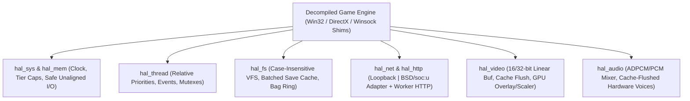

# Console Decomp Porting Guide: OS Pipelines, Hardware Traps & Portable HAL Blueprint

> **Purpose:** Distills architectural lessons from bringing a 1999/2000 32-bit x86 decompiled PC engine (`nox-decomp`) onto real **Nintendo 3DS (`libctru` / Horizon OS)** hardware, why **emulators (`Citra` / `Azahar`) hide real-hardware failures**, and how to structure a **reusable POSIX/Platform HAL** for porting decompiled games across **Old 3DS, New 3DS, Nintendo Switch (`libnx`), PS Vita, and Desktop**.
>
> See also: [`3DS_HARDWARE_LEARNINGS.md`](./3DS_HARDWARE_LEARNINGS.md) for Nox-specific constants, functions, and post-mortems.

---

## 1. Console OS & Hardware Pipelines Comparison

| Subsystem | 2000 PC Baseline (Nox Target) | Old 3DS / 2DS (`CTR`) | New 3DS / New 2DS XL (`KTR`) | Nintendo Switch (`NX` — V1/V2/Lite/OLED) |
| :--- | :--- | :--- | :--- | :--- |
| **OS / Kernel** | Win98 / Win2000 (Preemptive SMP) | **Horizon OS** (`Kernel11` + `Kernel9` microkernel) | **Horizon OS** (`Kernel11` + `Kernel9` microkernel) | **Horizon OS** (64-bit microkernel) |
| **CPU & Clock** | Pentium II `200–450 MHz` (3-wide OoO) | `2× ARM11 MPCore` (`ARMv6K`) @ **`268 MHz`** (In-order) | `4× ARM11 MPCore` (`ARMv6K`) @ **`804 MHz`** (In-order) | `4× Cortex-A57` (`ARMv8-A`) @ **`1.02–1.78 GHz`** (OoO) |
| **Pointer / ABI** | **32-bit `ILP32`** (`sizeof(void*) == 4`) | **32-bit `ILP32`** (`sizeof(void*) == 4`) | **32-bit `ILP32`** (`sizeof(void*) == 4`) | **64-bit `LP64`** (`sizeof(void*) == 8` in `libnx`) |
| **Caches** | `32 KB` L1 + **`512 KB` L2** | `16 KB` I / `16 KB` D, **No L2 cache** | `32 KB` I / `32 KB` D + **`2 MB` L2 cache** | `48 KB` I / `32 KB` D + **`2 MB` L2 cache** |
| **SIMD / Math** | `x87` FPU + `MMX` + HW `IDIV` | `VFPv2` (scalar), **No NEON**, **No `SDIV`/`UDIV`**, ARMv6 `UQADD8` SWAR | Same as Old 3DS (3× clock) | Full **64-bit NEON SIMD** + HW `SDIV`/`UDIV` + `FPU` |
| **App RAM** | `32–128 MB` | **`64 MB`** (`80 MB` extended mode) FCRAM | **`124 MB`** (`178 MB` extended) FCRAM | **`~3.2 GB`** usable `LPDDR4` |
| **Usable App Cores** | All cores | **Core 0 only** (Core 1 = OS sysmodules) | **Core 0 + Core 2** (Core 1 = OS, Core 3 = QTM/OS) | **Cores 0, 1, 2** (Core 3 = OS) |
| **GPU** | DirectDraw 2D surface flip | **PICA200** (`citro3d`/`citro2d` fixed-function + VSH) | **PICA200** (same GPU, `6 MB` VRAM) | **NVIDIA Maxwell** (`deko3d` / OpenGL 4.6 / Vulkan) |
| **Cache Coherency** | Hardware snooped | **Non-coherent** (manual `GSPGPU`/`DSP` cache flush) | **Non-coherent** (manual `GSPGPU`/`DSP` cache flush) | Coherent w/ GPU SMMU mappings (barriers via `deko3d`) |

---

## 2. Deep-Dive: 3DS / Horizon OS Pipelines vs. Emulators

Emulators (`Citra`, `Azahar`, `Lime3DS`, `Ryujinx`) use **High-Level Emulation (HLE)**: OS service calls (`soc:u`, `http:C`, `fs:USER`, `gsp:GPU`) are intercepted and executed by your desktop OS kernel, SSD, `libcurl`/TLS stack, and x86_64/ARM64 CPU. **Code that runs at 60 FPS in an emulator can lock to 20 FPS, drop packets, or `Data Abort` immediately on real hardware.**

### 2.1 Dual-CPU & Microkernel Thread Scheduler (`Kernel11`)
- **Hardware Split:** On 3DS, an `ARM946E-S` (`134 MHz`) runs `Process9` (crypto, NAND, SDMC controller), while the `ARM11 MPCore` runs `Kernel11`, isolated user-space sysmodules (`soc:u`, `fs:USER`, `http:C`, `gsp:GPU`, `dsp:DSP`), and the game.
- **Pinned Core Affinity (No Thread Migration):**
  - Every thread is pinned to a fixed `processor_id` at `svcCreateThread` time. `Kernel11` **never** migrates runnable threads to idle cores.
  - On **Old 3DS**, Core 2 does not exist (`threadCreate` on Core 2 returns `NULL`). Always check `APT_CheckNew3DS()` and fall back to `processor_id = -2` (default Exheader core = Core 0).
  - Avoid `APT_SetAppCpuTimeLimit(30)` to run app workers on **Core 1**: contending with `soc:u` (Wi-Fi) and `fs:USER` (SD card) on Core 1 introduces periodic multi-millisecond frame stalls.
- **Strict Priority Preemption (`0x00` Highest .. `0x3F` Lowest; Main = `0x30`):**
  - Unlike Linux's CFS fair scheduler, `Kernel11` has **no dynamic priority decay**. A higher-priority thread (`0x28`) spinning on Core 0 will starve the `0x30` main loop forever. Equal-priority threads (`0x30` & `0x30`) run cooperatively/FIFO until one blocks or calls `svcSleepThread(0)`.
  - **Rule for Worker Threads:** Query `svcGetThreadPriority(&main_prio, CUR_THREAD_HANDLE)` and spawn background I/O or HTTP workers at **`main_prio + 2`** (`0x32`). On New 3DS they run concurrently on Core 2; on Old 3DS they run on Core 0 strictly during VBlank/IPC idle gaps without ever preempting rendering, sleeping at 0% CPU on a `LightEvent` when idle.

### 2.2 CPU Execution, Alignment & Memory Hierarchy
- **Zero Unaligned Trap Emulation:**
  - `ARM11` supports unaligned single-word `LDR`/`STR`/`LDRH`/`STRH` in hardware (`SCTLR.U = 1`), **but unaligned `VLDR`/`VSTR` (`float*`/`double*`), `LDM`/`STM`, `LDRD`/`STRD`, or `LDREX`/`STREX` immediately crash with a fatal `Data Abort`**.
  - Decompiled 1990s x86 network packets, binary asset headers (`.idx`/`.bag`), and save structs pack 16/32-bit fields at arbitrary odd byte offsets. Always access unaligned fields via `memcpy`-based helpers (`nox_read_u16/u32/f32`, `nox_write_u16/u32`), and never `#pragma pack` float structs if pointers to their members are passed around.
- **No NEON, Expensive `VFPv2` Divides, No Integer `IDIV`:**
  - Never pass `-ftree-vectorize` on `ARMv6K` (bloats `16 KB–32 KB` L1 I-cache with scalar unrolled code).
  - `VFPv2` `VDIV.F32`/`VDIV.F64` is unpipelined (~14–30 cycles) and `VMOV` between VFP and ARM registers stalls the in-order pipeline; ARM11 also lacks integer `SDIV`/`UDIV` (`__aeabi_idiv` software routine).
  - **Fast Path:** Use fixed-point shifts (`Q16`/`Q20`), small `< 2 KB` reciprocal LUTs (which stay hot in L1 D-cache), 32-bit two-pixel **SWAR** (SIMD Within A Register) on aligned framebuffers, and ARMv6 saturating instructions (`UQADD8`, `QADD16`) for additive/particle blending.
- **Cache-Size Discipline (`16 KB` O3DS / `32 KB` N3DS L1 D-Cache):**
  - Giant `64–256 KB` lookup tables that speed up desktop CPUs thrash ARM11's L1 cache (and obliterate Old 3DS, which has **no L2 cache**). Keep hot lookup tables $\le 1\text{–}4\text{ KB}$.

### 2.3 Display Scanout (`PDC0`/`PDC1`), VBlank Phase & PICA200 DMA
- **Dual-LCD VBlank Phase Trap:**
  - Emulators fire Top (`VBlank0`) and Bottom (`VBlank1`) simultaneously; real 3DS LCD controllers offset them by several milliseconds.
  - Never use `C3D_FrameRate(30.0f)` + `C3D_FrameBegin(C3D_FRAME_SYNCDRAW)` for 30 FPS games on dual screens — out-of-phase 2-VBlank counters force a **3-VBlank wait (`50.14 ms` = 20 FPS)**. Instead, leave `citro3d` at `60.0f`, pace manually to 2× `GSPGPU_EVENT_VBlank0` ticks (`33.43 ms` = `29.92 Hz`), call `C3D_FrameBegin(0)`, and disable the PC engine's wall-clock `33.33 ms` sleep/frame-skip loop so beat frequencies don't stutter every ~10 seconds.
- **Zero-CPU Pixel Upload & Scaling:**
  - Render software engines directly into a hardware-native 16-bit format (`RGBA5551` or `RGB565`) in `linearAlloc` memory $\rightarrow$ `GSPGPU_FlushDataCache()` $\rightarrow$ `C3D_SyncDisplayTransfer()` (hardware Morton tiling into VRAM) $\rightarrow$ PICA200 textured quad scaling (`0.0 ms` CPU).

### 2.4 Real-Hardware Networking (`soc:u`, `http:C`, Home Wi-Fi)
1. **`poll()` Bitmask Mismatch:** `libctru` `<poll.h>` defines `POLLOUT=0x04, POLLERR=0x08`, whereas real `soc:u` uses `POLLWRNORM=0x08, POLLERR=0x20, POLLNVAL=0x80`. Always translate between POSIX `POLL*` and hardware `CTR_SOC_POLL*` inside the socket HAL.
2. **Per-Call Socket Flags:** Real `soc:u` rejects `MSG_DONTWAIT` on `sendto()`/`send()`. Set `O_NONBLOCK` once via `fcntl()` at `socket()` creation and pass `flags = 0` on normal sends/receives.
3. **Endianness & Ephemeral Ports:** `SOCU_GetIPInfo()` returns IPv4/mask/broadcast in **little-endian** order on real hardware (verify against big-endian `gethostid()`). Explicitly pick unused ephemeral UDP ports (`49152+`, tick-seeded + `SO_REUSEADDR`) when `bind(port=0)` is requested.
4. **Unconnected UDP ICMP Errors:** Drain `ECONNRESET`/`ECONNREFUSED`/`EHOSTUNREACH`/`ENETUNREACH` inside `recvfrom()`/`FIONREAD` loops and map them to `EWOULDBLOCK` so subnet scans don't abort packet draining.
5. **Single-Core Socket Ownership:** Never share one `soc:u` UDP descriptor across Core 0 and Core 2 without queuing TX/RX onto Core 0. Serialize `gethostbyname()` behind a mutex + small TTL cache.
6. **Outdated Console TLS (`http:C`):** Legacy handhelds lack TLS 1.3 and modern root CAs. Provide a non-blocking raw-TCP HTTP/1.1 client (optionally paired with embedded `BearSSL`/`mbedTLS` for HTTPS) on the lobby worker thread.
7. **Home Wi-Fi Router Realities:** Assume `255.255.255.255` UDP broadcast is dropped and **NAT hairpinning is absent**. Combine directed subnet broadcast + throttled `/24` unicast probes, and upgrade WAN lobby IPs to private LAN IPs dynamically (including mid-handshake peer-IP rewrites).

---

## 3. Blueprint: Portable POSIX / Console HAL for Decomp Ports

To port decompiled Win32/x86 games cleanly across **3DS (`libctru`), Switch (`libnx`), Vita (`vitaSDK`), Web (`Emscripten`), and Desktop (`POSIX/SDL2`)** without scattering `#ifdef`s across decompiled translation units, isolate platform differences behind **6 thin HAL modules**:

### Module Checklist for Effortless Cross-Console Porting

1. **`hal_sys` — Hardware Capabilities & Alignment Primitives**
   - Expose runtime hardware tier flags (`hal_caps_t`: `cpu_mhz`, `l2_cache_kb`, `ram_mb`, `has_second_app_core`, `has_twin_stick`) so engines auto-tune defaults (e.g., disabling software particle glow / shrinking `.bag` caches on `268 MHz` Old 3DS while keeping full detail on `804 MHz` New 3DS and Switch).
   - Provide `hal_read_u16/u32/u64/f32` and `hal_write_*` (`__builtin_memcpy`) as first-class primitives for all binary/network parsing.

2. **`hal_thread` — RTOS-Safe Threading & Synchronization**
   - Never expose raw OS core numbers or raw priority integers to game code. Expose semantic priorities (`HAL_THREAD_PRIO_LOW_BG`, `HAL_THREAD_PRIO_NORMAL`, `HAL_THREAD_PRIO_AUDIO_IRQ`) and `HAL_CORE_PREFER_BACKGROUND` (which automatically picks Core 2 on New 3DS, Core 1/2 on Switch, and falls back to Core 0 at `main_prio + 2` on Old 3DS).
   - Standardize on event variables (`hal_event_wait` / `hal_event_signal`) rather than polling `sleep()` loops.

3. **`hal_net` & `hal_http` — Normalized Non-Blocking Socket Vtable**
   - **Dual-Backend Switch:** Start in a zero-syscall **in-memory loopback vtable** for single-player/offline play (instant boot in Airplane Mode), switching lazily to the Wi-Fi socket backend only when entering Multiplayer.
   - **Quirk Normalization Inside the Backend:** Translate `poll()` bitmasks, strip unsupported `send`/`sendto` flags, synthesize `ioctl(FIONREAD)` via a 1-packet UDP prefetch slot, swallow transient UDP ICMP errors, assign explicit ephemeral ports on `bind(0)`, and keep all socket syscalls on the owner thread via a lock-free/mutex TX queue.
   - **Built-in NAT/LAN Helper & Embedded HTTP:** Bundle directed-broadcast + throttled LAN sweep helpers and a tiny raw-socket HTTP/1.1 (+ optional `BearSSL`) client so matchmaking works identically on 3DS, Vita, Switch, and PC.

4. **`hal_fs` — SDMC-Friendly Virtual Filesystem**
   - Case-insensitive path resolution cached in RAM (avoiding repeated directory scans on FAT32 SD cards).
   - Cluster-aligned (`4 KB–32 KB`) write batching and dirty-only flush on save/suspend hooks (`APTHOOK_ONSUSPEND` / Switch applet focus loss) so synchronous SD card writes never stall the 30/60 Hz loop.

5. **`hal_video` & `hal_audio` — Explicit DMA Coherency & GPU Assist**
   - Explicit `hal_video_UploadFrame(rect)` and `hal_audio_SubmitWaveBuf(ch, buf)` boundaries that perform required `FlushDataCache` calls on non-coherent ARM consoles (3DS) and become zero-cost no-ops or staging uploads on coherent GPUs (Switch/Desktop).
   - Optional **2D GPU Sprite/Primitive Overlay Pass** (native vector/bitmap fonts, HUD, additive radial particle glows) composited over the software framebuffer at native screen resolution.

6. **Solving `32-bit (ILP32)` $\rightarrow$ `64-bit (LP64)` for Switch (`aarch64`) & Modern Consoles**
   - *3DS (`ARMv6K`) and Vita (`Cortex-A9`)* are natively `ILP32` (`sizeof(void*) == 4`), matching 1990s Win32 x86 decompilations where pointers are stored inside `int` / `_DWORD` struct fields.
   - *Switch (`libnx`)* is strictly `64-bit aarch64` (`LP64`, `sizeof(void*) == 8`). When porting a 32-bit decomp to Switch, choose one of two clean strategies up front:
     1. **4 GB Contiguous Arena (`vm32` base pointer):** Reserve a single `< 4 GB` virtual address arena for all game heap + `.data`/`.bss` allocations so every game pointer converts losslessly to/from a 32-bit offset (`ptr = g_arena_base + offset32`), or
     2. **Type-Widening Pass (`intptr_t`):** Audit pointer-carrying fields/globals (guided by `-Wint-to-pointer-cast` / `-Wpointer-to-int-cast`) so the C codebase compiles cleanly as native 64-bit on Switch, macOS Apple Silicon, Linux ARM64, and x86_64 alike.
